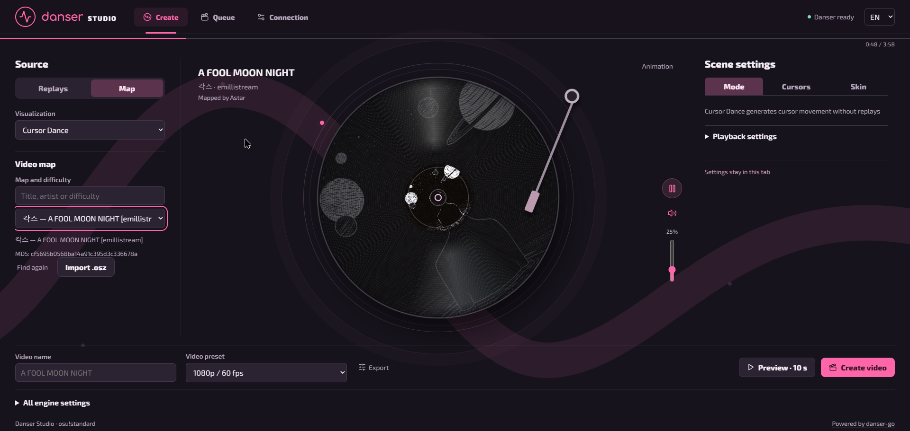

# Danser Studio · v0.3.0

A local video studio for **osu!standard**, built on [danser-go](https://github.com/Wieku/danser-go). Create videos from replays or visualize a map with Cursor Dance / Autoplay. Available in English and Russian.

The modified engine lives in a separate [Studio engine fork](https://github.com/ilyaminch/danser-go), linked to the original [Wieku/danser-go](https://github.com/Wieku/danser-go). This repository stores only a pinned Git submodule reference at `danser-go/`, rather than a vendored copy of its sources. Studio-specific engine changes are documented in [STUDIO.md](https://github.com/ilyaminch/danser-go/blob/a3a63324/STUDIO.md).



## Features

- Import `.osr` attempts of one exact map version, matched by MD5.
- Use maps from stable Songs, read-only lazer storage, or `.osz` imports.
- Choose comparison modes, elimination rules, a date gradient, and individual attempt colors. Hit counts stay visible on each attempt.
- Load local skins or `.osk` archives; keep access to all engine settings.
- Export MP4/MKV, make short video previews or PNG screenshots, and manage jobs with progress, logs, cancellation, and retry.
- Listen from the map's `PreviewTime`, with seeking, volume, mute, and optional animation.

Settings stay in the browser tab session. Uploaded replay copies are deleted after successful full renders once other jobs no longer need them. Preview, errors, and cancellation keep the copies; original files are untouched.

## Setup — Windows x64

Requires **Node.js 24+**, **FFmpeg/ffprobe**, and the Studio engine with its runtime assets. There is no installer yet.

```powershell
git clone --recurse-submodules https://github.com/ilyaminch/danser-go-webui.git
cd danser-go-webui/web
npm ci
npm run build
cd ..
```

1. Extract the Windows x64 [danser-go 0.12.0 archive](https://github.com/Wieku/danser-go/releases/tag/0.12.0) into `runtime/`, preserving assets and DLLs.
2. Place Go 1.26.1 at `.tools/go/` and WinLibs GCC x64 (POSIX, MSVCRT; tested with 16.2.0) at `.tools/mingw64/`. Run `./Build-Engine.ps1` to build `runtime/danser-studio.exe`.
3. For lazer support, install .NET SDK 9+ and run `./Build-LazerIndex.ps1`.
4. Open `Start-Studio.cmd`, then configure FFmpeg and map sources under **Connection** at **http://127.0.0.1:3000**.

For an existing checkout, run `git submodule update --init --recursive` after pulling WebUI changes. This checks out the engine commit recorded by WebUI. ZIP downloads do not contain submodule sources; use Git for development/building. Engine updates require an explicit submodule commit change and review, rather than tracking a moving branch. The current engine pin includes native security changes awaiting isolated tests and build validation; it is not a new validated release.

## Use

Under **Create**, import replays or choose **Map** and a visualization mode. Set the engine mode, cursor colors, and skin; choose a video preset, optionally preview, then create the video. Results appear in **Queue**. Detailed encoding options and engine settings remain available below the workspace.

**New render** clears the current attempts while preserving session settings. You can upload another map while earlier jobs finish with their own replay copies and settings. Temporary copies are removed after a successful video; previews, failed jobs, and cancelled jobs retain their copies for retry.

The date gradient uses the entire loaded batch, so selecting attempts does not change their colors. Turning it off freezes the current colors; manual overrides remain in effect. Gradient editing opens beside the attempt list. Each attempt shows its timestamp and hit counts.

Map selection opens a searchable list with keyboard navigation. Completed videos open in a dedicated player with seeking, volume and fullscreen controls. Render logs remain available as downloads from the queue and result viewer.

Scenario changes, settings panels and controls provide short animated feedback, with reduced movement when requested by the operating system. The desktop workspace remains the primary layout; narrow screens place source selection first and use larger player controls. Queue polling uses compact updates without repeatedly downloading render logs or the map catalog.

Replay videos retain recorded mods. CS/AR/OD/HP overrides apply only to map visualization. Default recording uses NVENC; select libx264 if hardware encoding is unavailable.

## Development

From `web/`:

```powershell
npm run dev
npm test
npm run build
```

Engine integration checks are in `web/test/integration.mjs` and require the engine, assets, and FFmpeg. Local data lives in `web/data/`; runtime, credentials, generated media, and development notes are excluded from Git.

WebUI code is developed here; engine changes belong in the fork. Keep the submodule checkout at its recorded commit during WebUI work. Develop and review engine changes on the fork's feature/fix branches first, then update the WebUI submodule reference. `Build-Engine.ps1` builds the pinned sources without formatting/modifying them, and includes native input-limit regressions and the nested replay decoder tests.

## Limitations and license

Studio binds to loopback and is intended for one trusted OS user. It is not a hosted multiuser service and has no authentication boundary between OS accounts. HTML responses disallow framing; existing Host/Origin and mutation-header checks remain enabled.

Import limits: 200 replays, 20 MiB per replay and 256 MiB of actual file payload per request (including chunked uploads). Imports run one at a time; multipart text fields are rejected. Map text is limited to 8 MiB with 64 KiB lines and parsed in a bounded worker. Archives retain a 1 GiB expanded budget and now count bytes while extracting.

The Studio engine restricts map backgrounds to the selected map directory, including symbolic link traversal, with the usual default-background fallback. External symbolic links cannot supply backgrounds; for lazer, keep the temporary view on the storage volume so hard links can be used. Replay decoding caps actual LZMA output at 64 MiB (4 MiB metadata), dictionaries at 16 MiB and frames at two million. Image decoding caps input at 64 MiB, dimensions at 8192 per side and 16 megapixels, with 256 MiB of live decoded pixmaps and 2 GiB of texture storage including mipmaps. These engine changes require rebuilding `danser-studio.exe`.

Optional map videos use owner-selected FFmpeg and are disabled by default. Secondary media references depend on the FFmpeg build and need separate isolated validation; file-path checks alone do not sandbox the subprocess.

One map per video; no automatic map download, editing across maps, or render pause. The tested platform is Windows; Linux packaging is untested and upstream does not support macOS. Compatibility with every lazer replay/mod combination is not guaranteed.

This is an unofficial companion with a modified engine. See the [engine documentation](https://github.com/ilyaminch/danser-go/blob/a3a63324/README.md), [engine credits](https://github.com/ilyaminch/danser-go/blob/a3a63324/CREDITS.md), [asset notices](web/public/ASSETS.md), and [GPL-3.0 license](LICENSE). Original engine authorship and third-party license notices are preserved in the fork. The `v0.2.0` tag preserves the version before the frontend redesign.
