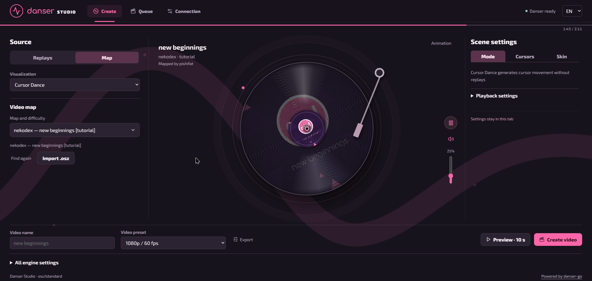

# Danser Studio

A local video studio for **osu!standard**, powered by [Wieku/danser-go](https://github.com/Wieku/danser-go). Compare your attempts over time, render friends' replays together, or visualize a map with Cursor Dance / Autoplay. Available in English and Russian.



## Download and start

Download **DanserStudio-0.4.0-windows-x64.zip** from the [latest release](https://github.com/ilyaminch/danser-go-webui/releases/latest), extract it into a writable folder, and open **Start-Studio.cmd**. The application opens at **http://127.0.0.1:3000**. Keep the entire extracted folder together; avoid protected system folders.

Requires Windows 10/11 x64, a graphics driver supporting OpenGL 3.3, and internet access on first launch. Node.js, the Studio engine and the lazer index helper are bundled; no compiler, Node or .NET installation is needed. First launch downloads the original danser runtime resources and FFmpeg from their distributors, verifies pinned SHA-256 hashes, and installs them locally. These downloads may take a few minutes. Subsequent launches work offline with local maps.

Use **Stop-Studio.cmd** to cancel pending jobs and stop the local server. Closing the browser does not stop it. To use another port, run `./Start-Studio.ps1 -Port 3001`. If PowerShell is blocked by your organization's policy, follow that policy rather than disabling it globally.

For manual dependency installation, see [packaging/runtime-dependencies.json](packaging/runtime-dependencies.json). Place the original runtime assets/DLLs in `runtime/` and FFmpeg/ffprobe in `runtime/ffmpeg/`; preserve their license notices. Logs and application data live in `web/data/`. Output location can be changed under **Connection**. Updating is simplest by extracting the new release into a new folder; do not replace a running instance.

## Workflow

- **Replays:** upload one or more `.osr` attempts of the same exact map version. Each attempt displays its date and 300/100/50/miss counts. Choose comparison and elimination rules, set colors manually or apply an editable gradient over the entire batch by date.
- **Map:** select a map for Cursor Dance or Autoplay without uploading replays. Difficulty overrides apply here; replay videos keep their recorded mods.
- Resolve maps from stable **Songs**, read-only **osu!lazer storage**, or imported `.osz` archives. Missing maps can be imported manually; maps are matched using the replay's identity, not just their title. There is no automatic online map download.
- Choose local skins or import `.osk`, adjust export and engine settings, optionally preview ten seconds, then create the video. Results appear in **Queue** with a video player, download actions and downloadable logs.

**New render** accepts another map while previous jobs retain their own inputs and settings. Settings persist within the browser tab session. Uploaded replay copies are removed after successful full renders once no other job needs them; previews, failures and cancellation retain copies for retry. Original files are untouched. A queue item whose inputs were removed cannot reproduce the original render.

Turning the date gradient off preserves existing colors; individual overrides remain effective. Selection does not rescale the batch gradient. Rendering defaults to H.264 NVENC when available; a fresh session falls back to libx264 after a hardware capability probe. Existing session choices are preserved. Export resolution/FPS and encoding preset have a large effect on rendering speed.

The desktop layout is primary. Searchable map selection, branded video controls, compact queue updates and short action animations support keyboard navigation and reduced motion. The animated record is a workspace visualization, not a live native preview of the final render.

## Source and development

This repository contains WebUI and a pinned submodule for our [Studio engine fork](https://github.com/ilyaminch/danser-go). The fork preserves the original engine history and adds fixed per-replay colors, a manifest adapter and native input limits; see its [STUDIO.md](https://github.com/ilyaminch/danser-go/blob/main/STUDIO.md). WebUI never tracks a moving engine branch.

```powershell
git clone --recurse-submodules https://github.com/ilyaminch/danser-go-webui.git
cd danser-go-webui/web
npm ci
npm test
npm run build
cd ..
```

After pulling, run `git submodule update --init --recursive`. GitHub's automatic source ZIP does not expand submodules; use the **DanserStudio-0.4.0-source.zip** release asset for complete sources, including engine dependency sources. See [SOURCE.md](SOURCE.md).

Source builds require Node.js 24+, Go 1.26.1 at `.tools/go/`, WinLibs GCC x64 POSIX/MSVCRT at `.tools/mingw64/` (tested with 16.2.0), and .NET SDK 10 for lazer support. Prepare original runtime dependencies with `./Initialize-Runtime.ps1`, then run `./Build-Engine.ps1` and `./Build-LazerIndex.ps1`. Install FFmpeg in `runtime/ffmpeg/` or configure its executable under Connection. `./Build-Package.ps1` produces the portable Windows package; a tested engine/helper must already exist in `.local-work/release-runtime/` by default. No real maps, replays, output media or credentials are published.

From `web/`, `npm run dev` starts development mode. `node test/integration.mjs --manual` exercises synthetic imports and real native video/screenshot rendering in a separate data directory. `STUDIO_TEST_ROOT`, `STUDIO_TEST_ENGINE` and `STUDIO_TEST_FFMPEG` can select a package for integration testing. Native regression tests run as part of Build-Engine.

Conventional Commits and GitFlow are used: feature/fix branches target `develop`; releases merge into `main` and back into `develop` with merge commits.

## Safety and limits

Studio binds to loopback and is intended for one trusted OS user on a local computer. It has no authentication boundary between OS accounts and is not a hosted multiuser service. HTML responses reject framing; API requests retain Host/Origin and mutation-header checks.

Imports allow 200 replays, 20 MiB per replay and 256 MiB of actual payload per request, including chunked uploads. Expensive imports are serialized; multipart text fields are rejected. Maps are limited to 8 MiB / 64 KiB lines and parsed in a bounded worker. Archives have a 1 GiB expanded budget with byte accounting during extraction.

The native engine restricts map backgrounds to the selected map directory at file opening, including symbolic link traversal, and falls back to the default background. For lazer, keep the temporary view on the storage volume to allow hard links. Replay decoding limits output, dictionaries and frame count; image dimensions, decoded memory and texture storage are bounded. Unit/native regressions and synthetic rendering pass on Windows. The file-symlink test requires a Windows privilege unavailable on the test host; the directory-junction escape regression passes. These limits do not sandbox the entire renderer.

Map videos are disabled by default. FFmpeg secondary-resource behavior and access from another OS account remain conditional, unverified security hypotheses requiring separate disposable-environment validation. No confirmed exploitation or severity is claimed. Use trusted local inputs and the published dependency versions.

One map per video; no render pause or cross-map timeline editing. Windows x64 is the packaged platform. Linux packaging is untested; upstream does not support macOS. Compatibility with every lazer replay/mod combination is not guaranteed.

## License and attribution

Unofficial companion to [danser-go](https://github.com/Wieku/danser-go); not affiliated with osu!. Original engine authorship and notices are preserved. Studio code and engine modifications are distributed under [GPL-3.0](LICENSE); release binaries have corresponding source archives. See [THIRD_PARTY_NOTICES.md](THIRD_PARTY_NOTICES.md), [engine credits](https://github.com/ilyaminch/danser-go/blob/main/CREDITS.md) and [UI asset notices](web/public/ASSETS.md).

Runtime assets and BASS have separate conditions; the code license does not grant rights to every resource. Original runtime resources and FFmpeg are fetched from their distributors rather than republished inside the Studio package. BASS's free use is subject to its non-commercial terms. Preserve the downloaded notices and obtain any permissions needed for your use.
